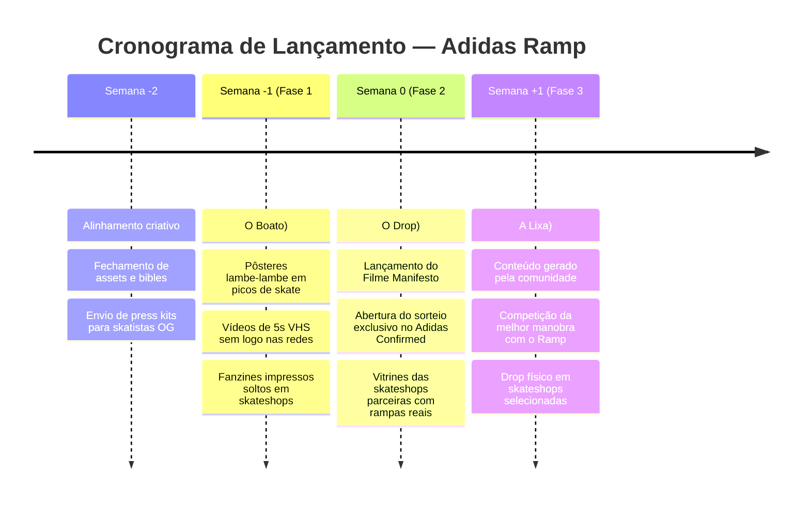

# Plano de Produção — Campanha Adidas Ramp 90s

## 1. Resumo Executivo
- **Projeto**: Campanha 360° do Retorno do Tênis Adidas Ramp (Anos 90).
- **Abordagem Criativa**: 100% crua, visceral e analógica (Skate underground, VHS, Fanzine DIY, Concreto e Lixa).
- **Escopo**: Campanha completa end-to-end (Conceito, Roteiro, Arte, Prompts de Imagem, Anúncios Multi-formato, Copy-Pack, Calendário de Mídia e Multiplicação).
- **Duração do Ciclo da Campanha**: 3 semanas de ativação (Fase 1: Sussurro / Teaser; Fase 2: O Drop / Manifesto; Fase 3: Comunidade & Lixa / Sustentação).

## 2. Matriz de Entregáveis e Definition of Done (DoD)

| Entregável | Agente Responsável | Apoio | Definition of Done (DoD) |
|---|---|---|---|
| **Dossiê de Pesquisa & Scout** | Sondagem | Planejamento | Triangulação histórica da cena skate 90s, vocabulário autêntico, referências de fitas VHS (411VM) e mapa de concorrentes concluído. |
| **Big Idea & Conceito** | Conceito | Roteiro | Manifesto central, tagline oficial ("Feito pra lixa, não pra vitrine"), ângulos de abordagem e diferenciação validados. |
| **Roteiro do Filme Manifesto** | Roteiro | Conceito, Arte | Roteiro cena a cena (45s e 15s) com trilha de áudio lo-fi/boom-bap, locução visceral e marcações de tempo precisas. |
| **Bíblia Visual (Art Bible)** | Arte | Conceito | Definição de paleta cromática, tipografia distressed/xerox, enquadramento fisheye (VX1000), texturas de filme 35mm e diretrizes fotográficas. |
| **Storyboard da Campanha** | Storyboard | Arte, Roteiro | Grade de 8 quadros sequenciais com especificações visuais de corte, ação do skatista, foco no calçado e transições analógicas. |
| **Folha de Produção & Prompts** | Operação | Arte | Prompts calibrados para geração em ferramentas de IA (Key Visual, fotos de detalhe de produto em lixa, still de calçado sujo de cera, cenas de ação). |
| **Copy-Pack Completo** | Roteiro | Mídia | Copies de anúncios pagos (9:16, 4:5, 16:9), legendas orgânicas para Instagram/TikTok, e-mail para membros Confirmed e press release para mídia especializada. |
| **Estratégia de Mídia & Calendário** | Mídia | Planejamento | Cronograma de 21 dias com canais prioritários, distribuição de conteúdo por fase e matriz de hashtags autênticas. |
| **Matriz de Multiplicação** | Transformação | Mídia | Desdobramento em stickers de fanzine, pôsteres lambe-lambe para skateshops, fitas VHS promocionais e ativação de guerrilha física. |
| **Documento Visual de Apresentação** | Edição | Todos | HTML editorial visual consolidando toda a inteligência da campanha pronto para apresentação executiva. |

## 3. Cronograma Reverso (Backward Planning)

## 4. Caminho Crítico (Critical Path)
1. **Conceito & Big Idea** → 2. **Roteiro & Bíblia Visual** → 3. **Storyboard & Prompts** → 4. **Copies & Formatos Finais** → 5. **Documento Visual Consolidado**.

## 5. Mapeamento de Riscos e Planos de Contingência

| Risco | Probabilidade | Impacto | Plano de Contingência |
|---|---|---|---|
| A estética parecer "forçada" ou comercial demais | Média | Alto | Validação rigorosa com referências reais de zines da época (Thrasher 1995/1997, 411VM); veto absoluto a elementos visuais polidos ou render 3D glossy. |
| Desconexão entre os novos skatistas e o modelo retrô | Baixa | Médio | Usar skatistas da nova geração testando o tênis de verdade em picos clássicos (Praça da Sé, Vale do Anhangabaú, Love Park), provando a durabilidade na lixa. |
| Saturação de lançamentos retrô no mercado | Média | Médio | Focar na especificidade técnica do Ramp: ele é um tênis pesado, bruto e indestrutível, o oposto dos tênis leves descartáveis da atualidade. |
